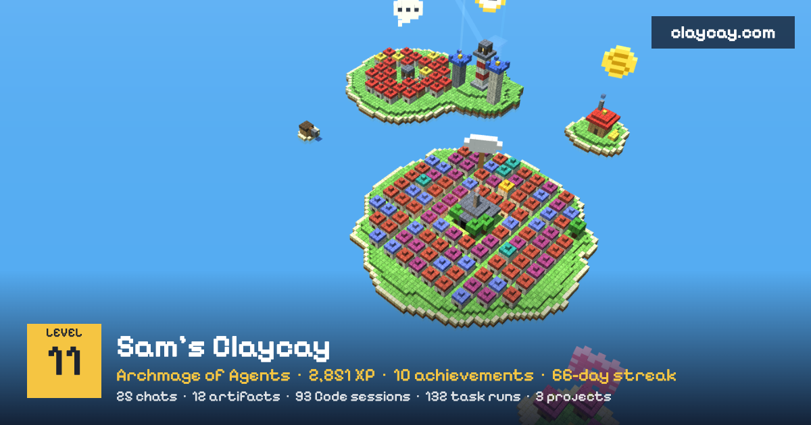

# Claycay

[](https://skills.sh/claycayworld/claycay)

Your Claude activity, grown into a blocky island world you can play through.

Chats become houses in a village. Artifacts get forged by the fire. Scheduled tasks stand
as towers, and when a run fails it bonks, smokes and complains in a speech bubble. Press
play and watch your history build itself day by day, with XP, levels, achievements and
quests on top.

[](https://claycay.com/demo)

**See one first:** [claycay.com/demo](https://claycay.com/demo) (Sam is made up, level 11).

## Install

**Claude Code**

```
/plugin marketplace add claycayworld/claycay
/plugin install claycay@claycay
```

**Claude app (chat or Cowork)**

Download [claycay.skill](https://claycay.com/claycay.skill) and add it in Claude under
Customize, then Skills. Works on paid plans with code execution turned on.

Then ask: *"Build my Claycay"*.

## What you get

- One HTML page, no account needed. Open it in any browser.
- An island per kind of activity: Chat Village, The Forge, Cowork Workshop, Project
  Archipelago, and a Scheduled Tasks island with a lighthouse, ghosts for duplicate tasks
  and gravestones for retired ones.
- 📸 Postcards: one tap saves a picture of your island with your level and counts (never
  titles), sized for social posts.
- 🐢 A pet turtle that hatches after a 2-day streak and grows with your longest one.
- ⛅ Weather from your last 7 days: sunny when you were busy, storms when scheduled runs
  failed, fog when nothing happened, and a rainbow after a storm.
- 🔨 Bug Bonk: steer the islander and bonk the gremlins your failed runs let loose. The
  waves are your three worst days. Just for fun: game points never count as XP.
- XP and levels (level 10 starts at 2,250 XP), 17 achievements plus a secret one, and
  quests taken from your own loose ends.
- 🧭 A coach: quests built from your own data (fix a task that keeps failing, give a pile
  of related chats a project) and ghost islands for parts of Claude you haven't tried yet.
- A league: post your score card on [claycay.com](https://claycay.com) and see where you stand.
  Friends can visit your island there, bonk your gremlins and stamp your guestbook.
- 🏅 Monthly seasons: each month ranks the XP earned in it, and the top 3 keep a badge.
- 👥 Crews: private leagues for a team or friends, joined with a link.
- 🗓️ Weekly updates: a scheduled task can grow your world and post your score each week.

Using ChatGPT, Gemini, Grok or DeepSeek too? Drop your data export on
[claycay.com](https://claycay.com) and get a world built in your browser. Nothing is uploaded.

## Privacy

- Your world is built on your side. Nothing is uploaded unless you post a score card.
- A score card holds counts and achievement ids only. No titles, no links, no notes.
- Sharing your world? Build it with `--redact` to hide chat titles, chat links and task notes.
- The card checksum catches typos, not cheaters. The league is for fun.

## What it reads, sends and fetches

- **Reads:** your Claude activity that the current session can see (chat and artifact
  titles and dates, projects, scheduled tasks and their runs). In Claude Code,
  `scripts/collect_claude_code.py` reads only timestamps and project folder names from
  `~/.claude/projects`, never message content. All of this stays in the HTML file it writes.
- **Fetches:** `https://claycay.com/skill-version.json` once per build, to say if a newer
  version is out. Nothing about you is sent with it.
- **Sends, only when you ask for your rank:** `scripts/rank.py` posts your score card (counts
  and achievement ids, no titles) to `https://claycay.com/api/rank`, which answers and stores nothing.
- **Your world page loads** three.js from `cdnjs.cloudflare.com` and fonts from Google Fonts.
  It has no analytics. Its links to claycay.com only open when you click them.
- **Posting to the league** happens only if you copy your card and paste it on claycay.com
  yourself. See the [privacy page](https://claycay.com/privacy) for what the site stores.

## Scoring

Chat 10, artifact 30, Code session 15, project 20, scheduled run 5 (delivered) down to 1
(a failure still counts, you showed up), achievement 25, quest 50. Same for everyone, so
worlds compare fairly.

## License

Source available under [PolyForm Shield 1.0.0](LICENSE.md): free to use, read and change,
including at work. The one thing it rules out is using this code to build a competing product.

## Links

- Website and league: [claycay.com](https://claycay.com)
- Privacy: [claycay.com/privacy](https://claycay.com/privacy)
- Listed on: [skills.sh](https://skills.sh/claycayworld/claycay) ·
  [claude-plugins.dev](https://claude-plugins.dev/skills/@claycayworld/claycay/claycay)
- Follow Cay: [X](https://x.com/claycayworld) · [Bluesky](https://bsky.app/profile/claycay.bsky.social) ·
  [Threads](https://www.threads.net/@claycayworld) · [Instagram](https://www.instagram.com/claycayworld) ·
  [TikTok](https://www.tiktok.com/@claycayworld)
- What's new: [claycay.com/#news](https://claycay.com/#news) and [Releases](https://github.com/claycayworld/claycay/releases)
- Questions: hello@claycay.com

---

Claycay is an independent project, not affiliated with or endorsed by Anthropic. Claude is
a trademark of Anthropic.
